<div align="center">

<picture>
  <source media="(prefers-color-scheme: dark)" srcset="./dark.svg">
  <source media="(prefers-color-scheme: light)" srcset="./light.svg">
  
</picture>

<br/>

<a href="https://zaheer-verse.vercel.app/"></a>
<a href="https://www.linkedin.com/in/zaheer-yousaf"></a>
<a href="https://github.com/Zaheer-verse"></a>
<a href="mailto:zaheery991@gmail.com"></a>

</div>

---

## `ABOUT.ME`

```bash
zaheer@verse:~$ whoami

Name       : Zaheer Yousaf
Education  : BS Computer Science — University of Sialkot
Location   : Daska, Sialkot, Pakistan
Focus      : IoT · Web Engineering · AI Developer Tools · EV & Energy Research
Status     : Building, learning, testing, improving
```

I’m a **Computer Science student** who enjoys building practical systems across software, hardware, automation, and research.

My work moves between **web applications**, **IoT and embedded systems**, **AI-assisted engineering workflows**, and **energy-focused research concepts**. I prefer projects I can understand end-to-end: what problem they solve, how the system works, where it can fail, and how the result can be tested.

Recently, I’ve also been exploring how AI coding agents can work more deliberately — clarifying requirements, breaking work into smaller tasks, writing tests before implementation, using isolated Git worktrees, reviewing changes, and verifying the result before calling it complete.

---

## `CURRENT.FOCUS`

```text
01  IoT & Embedded Systems
02  AI Coding Agents & Developer Workflows
03  React / TypeScript Web Applications
04  EV Wireless Charging & Road Energy Harvesting
05  Distributed Systems · Cloud · Cybersecurity
```

---

## `ENGINEERING.STACK`

### `LANGUAGES`

<p>
  
</p>

`C` `C++` `Python` `JavaScript` `TypeScript` `HTML` `CSS`

### `WEB`

<p>
  
</p>

`React` `Vite` `Tailwind CSS` `Node.js` `Responsive UI`

### `DATABASES & TOOLS`

<p>
  
</p>

`MongoDB` `MySQL` `Git` `GitHub` `VS Code` `Vercel`

### `EMBEDDED & IoT`

`ESP8266` `NodeMCU` `Arduino` `Blynk` `TCRT5000` `Sensor Integration` `Relay Control`

### `WORKFLOW`

`Test-Driven Development` `Git Worktrees` `QA` `Security Review` `AI Agent Skills` `LaTeX` `Overleaf`

---


## `GITHUB.ACTIVITY`

<div align="center">


<br/><br/>


<br/><br/>


</div>

---


